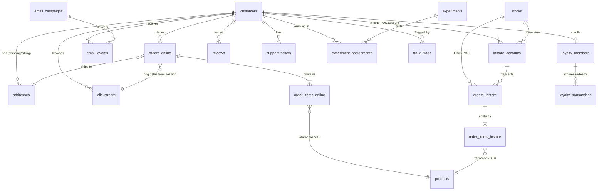

# AGENTS.md — Omnichannel Synthetic Ecommerce Data Generator

This repository contains a high-performance, referentially-intact synthetic data generator producing omnichannel ecommerce datasets (Small to XL) formatted as Snappy-compressed Apache Parquet and DuckDB databases.

This document serves as the primary guidance file for AI agents operating within or extending this repository.

---

## 🛠️ Environment & Setup

- **Python Version:** 3.11+
- **Virtual Environment:** `.venv` (in repository root)
- **Activate Environment:**
  ```bash
  source .venv/bin/activate
  ```
- **Install Dependencies:**
  ```bash
  pip install -e ".[dev]"
  ```
- **Run Test Suite:**
  ```bash
  pytest -v
  ```

---

## 📋 Deterministic CLI Reference

All CLI commands are accessible via `ecommerce-synth <command>` or `python -m ecommerce_synth <command>`:

| Command | Usage | Description |
|---|---|---|
| `generate` | `ecommerce-synth generate --tier <tier> [--duckdb] [--output <dir>]` | Generates full omnichannel dataset |
| `validate` | `ecommerce-synth validate <data_dir>` | Runs 29 referential integrity FK checks |
| `preview` / `inspect` | `ecommerce-synth preview <data_dir> <table_name> [--limit 5]` | Displays schema and sample rows |
| `profile` | `ecommerce-synth profile <data_dir> [--html <report.html>]` | Displays business KPI dashboard & GMV |
| `export-duckdb` | `ecommerce-synth export-duckdb <data_dir> [--output <path>]` | Bundles all 19 tables into DuckDB |
| `stream` | `ecommerce-synth stream <data_dir> [--speed 100] [--json]` | Chronological live event streamer |

---

## 🗂️ Table Architecture & Data Dictionary

The project generates **19 interrelated tables**. The full machine-readable schema catalog is located at `config/schema.json`.



---

## 🧭 Directory Structure

```
Ecommerce_synthetic/
├── AGENTS.md                         # Universal Agent instructions (this file)
├── README.md                         # Human user documentation
├── pyproject.toml                    # Build config and dependencies
├── config/
│   ├── default.yaml                  # Default generation parameters
│   ├── volume_tiers.yaml             # Small / Medium / Large / XL definitions
│   └── schema.json                   # Machine-readable 19-table schema dictionary
├── .agents/
│   └── skills/
│       └── ecommerce-synthetic/
│           └── SKILL.md              # Agent skill cheatsheet and query recipes
├── src/ecommerce_synth/
│   ├── __init__.py
│   ├── __main__.py                   # python -m ecommerce_synth entrypoint
│   ├── cli.py                        # Typer CLI definition
│   ├── config.py                     # Pydantic configuration loader
│   ├── persona.py                    # 7 behavioral customer personas + fraud engine
│   ├── orchestrator.py               # Dependency DAG pipeline executor
│   ├── incremental.py                # Incremental batch & daily simulation engine
│   ├── duckdb_exporter.py            # Standalone DuckDB bundle generator
│   ├── profiler.py                   # Business KPI dashboard & HTML report engine
│   ├── streamer.py                   # Real-time chronological event streaming engine
│   ├── generators/                   # Domain data generators (11 modules)
│   └── utils/
│       ├── temporal.py               # Seasonality, diurnal, and holiday patterns
│       └── writer.py                 # Parquet writer and _manifest.json builder
├── tests/                            # Pytest test suite (23 tests, 100% passing)
│   ├── test_generators.py
│   ├── test_integrity.py
│   ├── test_incremental.py
│   ├── test_duckdb_and_profiler.py
│   └── test_streamer.py
└── output/                           # Default directory for generated Parquet runs
```

---

## ⚡ Agent Guardrails & Invariants

1. **Referential Integrity is Mandatory:** Never break foreign-key relationships. Always run `ecommerce-synth validate <dir>` or `pytest tests/test_integrity.py` after modifying generators.
2. **Deterministic Reproducibility:** Every generator inherits `self.rng` seeded via `config.seed`. Given the same seed and tier, the output must remain identical.
3. **Columnar Performance:** Tabular outputs are constructed as native Polars DataFrames and serialized using Snappy-compressed Parquet. Avoid converting large tables to Python lists or dictionaries.
4. **Behavioral Realism:** Customer actions are strictly driven by `CustomerPersona` (Power Shopper, Regular, Occasional, Bargain Hunter, One-and-Done, Window Shopper, Fraudster). Do not assign random uniform behavior.
