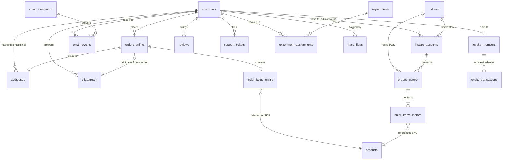

# 🛒 Ecommerce Synthetic Data Generator

A realistic, referentially-intact omnichannel synthetic ecommerce data generator capable of producing datasets at multiple volume tiers (Small to XL) formatted as Snappy-compressed **Apache Parquet** files.

---

## ✨ Features

- **Omnichannel Simulation:** Models both online e-commerce transactions and in-store Point-of-Sale (POS) purchases.
- **Referential Integrity:** Complete foreign-key consistency across 19 interconnected tables (customers, orders, line items, stores, catalog, clickstream, email, loyalty, reviews, support, experiments, fraud).
- **Behavioral Personas:** Generates realistic behavioral variations using customer personas (Power Shopper, Regular, Occasional, Bargain Hunter, One-and-Done, Window Shopper, Fraudster).
- **Full Clickstream Funnel:** Browsing sessions with realistic conversion funnels (`page_view` → `search` → `product_view` → `add_to_cart` → `begin_checkout` → `purchase`).
- **Fraud & Anomaly Injection:** Configurable fraud injection (card testing, account takeover, promo abuse, refund abuse, synthetic identity, velocity spikes) with ground-truth ML labels.
- **Incremental Generation:** Simulate daily pipeline loads ("give me yesterday's data") for testing ETL/ELT pipelines and data warehouses.
- **Configurable Scale:** Tiers from **Small** (500 customers, 1.5K orders) to **XL** (5M customers, 14M orders, 500M clickstream events).

---

## 📊 Volume Tiers

| Tier | Customers | Online Orders | In-Store Txns | Clickstream Events | Emails Sent | Loyalty Members | Support Tickets | A/B Assignments |
|------|-----------|---------------|---------------|--------------------|-------------|-----------------|-----------------|-----------------|
| **Small** | 500 | 1,000 | 500 | 50,000 | 5,000 | 300 | 150 | 400 |
| **Medium** | 50,000 | 100,000 | 40,000 | 5,000,000 | 500,000 | 30,000 | 12,000 | 40,000 |
| **Large** | 500,000 | 1,000,000 | 400,000 | 50,000,000 | 5,000,000 | 300,000 | 120,000 | 400,000 |
| **XL** | 5,000,000 | 10,000,000 | 4,000,000 | 500,000,000 | 50,000,000 | 3,000,000 | 1,200,000 | 4,000,000 |

*Fixed Dimensions: 2,000 products catalog, 50 retail stores.*

---

## 🚀 Quickstart

### Installation

```bash
# Clone the repository
git clone https://github.com/anilkulkarni87/ecommerce_synthetic.git
cd ecommerce_synthetic

# Create and activate virtual environment
python3 -m venv .venv
source .venv/bin/activate

# Install in editable mode
pip install -e ".[dev]"
```

### Basic Generation

```bash
# Generate a small dataset (default output: ./output/small_<timestamp>/)
ecommerce-synth generate --tier small

# Custom output directory and seed
ecommerce-synth generate --tier small --output ./data/test_run --seed 42

# Specific domains only
ecommerce-synth generate --tier small --only customers,products,orders_online

# Adjust fraud injection rate (default: 0.02)
ecommerce-synth generate --tier small --fraud-rate 0.05
```

### Validate Referential Integrity

Validates all 29 foreign-key and referential integrity constraints across all 19 generated Parquet tables:

```bash
ecommerce-synth validate ./output/small_<timestamp>/
```

### Preview & Inspect Tables

Inspect schema, row counts, and sample data directly from the terminal:

```bash
# Preview first 5 rows (default)
ecommerce-synth preview ./output/small_<timestamp>/ orders_online

# Customize row count
ecommerce-synth preview ./output/small_<timestamp>/ customers --limit 10

# Alias: inspect
ecommerce-synth inspect ./output/small_<timestamp>/ clickstream -n 3
```

### 🦆 Instant DuckDB SQL Bundle

Generate a standalone, zero-setup `ecommerce.duckdb` database preloaded with all 19 tables and analytical views (`v_omnichannel_sales`, `v_customer_360`):

```bash
# Generate data and export to DuckDB in one command
ecommerce-synth generate --tier small --duckdb

# Or export an existing Parquet run to DuckDB
ecommerce-synth export-duckdb ./output/small_<timestamp>/

# Query instantly with duckdb CLI:
duckdb ./output/small_<timestamp>/ecommerce.duckdb -c "
  SELECT channel, count(*), round(sum(total_amount), 2) as gmv
  FROM v_omnichannel_sales GROUP BY 1;
"
```

### 📊 Executive KPI & Behavioral Profiler

Compute omnichannel financial metrics, customer LTV, funnel drop-off, and fraud analytics in the terminal or export a standalone HTML report:

```bash
# Display Rich terminal dashboard
ecommerce-synth profile ./output/small_<timestamp>/

# Export executive HTML report
ecommerce-synth profile ./output/small_<timestamp>/ --html report.html
```

### Incremental Pipeline Simulation

```bash
# Generate 1 day of new data appended to an existing dataset
ecommerce-synth generate --tier small --incremental ./output/small_<timestamp>/ --days 1

# Simulate a week of daily batches (creates batches/day_1, batches/day_2, ...)
ecommerce-synth generate --tier small --incremental ./output/small_<timestamp>/ --days 7 --daily-batches
```

### 🌊 Real-Time Event Streamer

Replay synthetic clickstream events and orders sequentially in chronological order to simulate live streaming telemetry:

```bash
# Stream events in terminal (default 100x speed)
ecommerce-synth stream ./output/small_<timestamp>/

# Stream at 10x real-time speed, limited to first 100 events
ecommerce-synth stream ./output/small_<timestamp>/ --speed 10 --limit 100

# Stream with fixed 50ms interval between events
ecommerce-synth stream ./output/small_<timestamp>/ --interval-ms 50

# Output raw NDJSON / JSON Lines directly to stdout
ecommerce-synth stream ./output/small_<timestamp>/ --json --speed 0 | jq .

# POST live events to an HTTP Webhook (e.g. mock API, Kafka REST proxy)
ecommerce-synth stream ./output/small_<timestamp>/ --webhook http://localhost:8080/events

# Append live events into a .jsonl file
ecommerce-synth stream ./output/small_<timestamp>/ --output live_stream.jsonl --speed 0
```

---

## 🗂️ Table Architecture & Catalog

The pipeline generates **19 interrelated tables** with 100% referential integrity:



### Generated Parquet Files

1. `customers.parquet` (Demographics, persona, account metadata)
2. `addresses.parquet` (Billing and shipping addresses)
3. `products.parquet` (SKUs, categories, pricing, costs)
4. `stores.parquet` (Brick-and-mortar store locations)
5. `instore_accounts.parquet` (POS card tokens, phone links, store loyalty)
6. `orders_online.parquet` (Web/App orders, shipping, payment status)
7. `order_items_online.parquet` (Line items for online transactions)
8. `orders_instore.parquet` (POS register receipts, cashier IDs)
9. `order_items_instore.parquet` (Line items for POS transactions)
10. `clickstream.parquet` (Web/App browsing events and sessions)
11. `email_campaigns.parquet` (Marketing broadcast definitions)
12. `email_events.parquet` (Email delivery, opens, clicks, unsubscribes)
13. `loyalty_members.parquet` (Loyalty tier enrollment & balance)
14. `loyalty_transactions.parquet` (Point accruals and redemptions)
15. `reviews.parquet` (Customer product ratings and feedback)
16. `support_tickets.parquet` (Zendesk-style customer service tickets)
17. `experiments.parquet` (A/B testing campaign definitions)
18. `experiment_assignments.parquet` (Customer cohort variant allocations)
19. `fraud_flags.parquet` (Ground-truth ML anomaly and fraud labels)
20. `_manifest.json` (Generation metadata, timestamps, row counts)

---

## 🤖 AI Agent Integration & Schema Catalog

This repository is optimized for autonomous AI coding and data analytics agents:

- **`AGENTS.md`**: Universal operational instructions, architecture invariants, and guardrails for AI agents.
- **`config/schema.json`**: Machine-readable 19-table schema dictionary with explicit column types, nullability, primary keys, and foreign-key target definitions.
- **`.agents/skills/ecommerce-synthetic/SKILL.md`**: Agent skill cheatsheet and turnkey DuckDB SQL recipes for **Customer 360**, **Funnel Drop-off Analysis**, **Fraud Anomaly Detection**, and **Identity Resolution**.

---

## 🧪 Testing

Run the full pytest suite (23 unit and referential integrity tests):

```bash
pytest tests/ -v
```

---

## 📄 License

MIT
